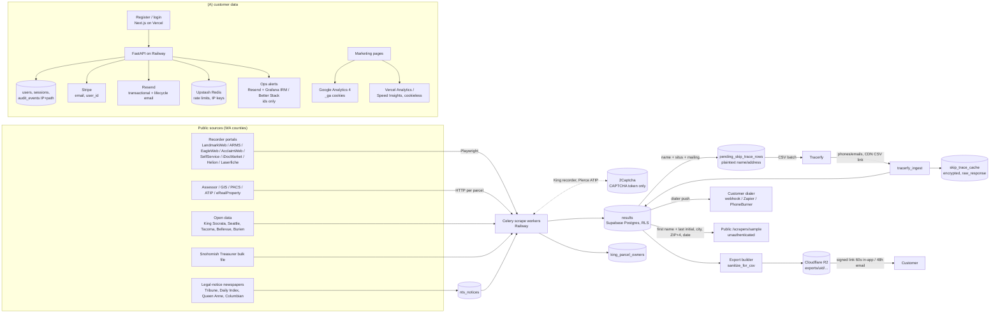

# Data processing inventory (as built, 2026-11-04)

**Source:** current code at backend `91398055` and frontend `b495637`. File references are relative to each repo.
Production configuration values are **code defaults** unless marked otherwise. The owner must confirm them (see
`01-...` B1-3). Not legal advice.

Two populations, kept separate throughout:
- **(A) Customers:** account holders.
- **(B) Data subjects in leads:** property owners, decedents, heirs, spouses and grantors named in public records. They never signed up.

## Data flow

## Processing inventory

| # | Activity | Population | Personal data | Source | Purpose | Storage | Recipients | Retention (actual) | Evidence |
|---|---|---|---|---|---|---|---|---|---|
| 1 | Account registration and auth | A | Email, bcrypt hash, password history, MFA secrets/backup codes, API key hash, sessions with user agent | Customer | Provide the service, security | `users`, `user_sessions`, `password_history` | Supabase, Railway | Life of the account. Tombstoned 30 days after a deletion request. | `models.py`, `account_deletion_beat.py:314-343` |
| 2 | Security / audit logging | A | IP, path, event, user_id | Requests | Security, fraud | `audit_events` (append-only), logs | Supabase, Railway logs | **Indefinite.** Only `detail` is scrubbed on account deletion. | `security.py:609-640`, `113:589-593` |
| 3 | Rate limiting | A (+ visitors) | IP-derived keys | Requests | Abuse prevention | Upstash Redis | Upstash | Short TTL | `rate_limit.py` |
| 4 | Billing | A | Email, Stripe customer id, plan, invoices | Customer, Stripe | Billing | `users`, Stripe | Stripe | Stripe id kept after deletion. The deletion email says billing records are kept 7 years. The Stripe Customer is deleted after the account purge. | `billing.py:1152`, `account_deletion_beat.py:459-490` |
| 5 | Lifecycle and transactional email | A | Email, plan, usage. The lockout email carries the IP. | System | Service messages, **promotion** (nudges, trial-ending upsell) | Resend | Resend | Resend's own retention [Unverified] | `onboarding_emails.py`, `delivery.py` |
| 6 | Web analytics | Visitors (incl. A when browsing marketing pages) | GA client id cookie, scrubbed URL, origin-only referrer, title, UA/device, approximate location | Browser | Site measurement | Google, Vercel | Google, Vercel | GA property setting [Unverified]. Vercel hash 24h. | `site-analytics.tsx:40-112` |
| 7 | Public-record collection | B | Names (party, decedent, heirs, spouse in `heirs`), property and mailing address, parcel, legal description, record type and date, amounts (delinquent, default, NTS principal), auction date | County portals, newspapers, open data | Lead compilation | `results`, `county_records` (orphaned), `nts_notices`, `king_parcel_owners` | Supabase | `county_records` 365 days (weekly purge, always on). **`results` lead rows, `nts_notices` and `king_parcel_owners` are never purged.** | `scheduler_helpers/county.py:10-31`, `119`, `118` |
| 8 | Owner matching / enrichment | B | Owner name, mailing address per parcel | Assessor / GIS / PACS / ATIP / eRealProperty | Find who owns the property | `results`, `king_parcel_owners` | (sources only) | As row 7 | `enrich.py:1550-1557`, `county_gis.py` |
| 9 | Contact enrichment (skip trace) | B | **Sent:** first/last name, situs and mailing address. **Returned:** up to 5 mobile, 3 landline, 5 email, phone type. No DNC. | Tracerfy | Deliver contact data to the customer | `pending_skip_trace_rows` (plaintext), `results` (encrypted), `skip_trace_cache` (encrypted incl. `raw_response`) | Tracerfy (both directions). Tracerfy hosts a result CSV at an unauthenticated CDN URL. | PII on `results`: 365 days, **only if `RETENTION_PURGE_ENABLED`**. Cache: 90 days (same gate). CDN URL cleared at 30 days (same gate). `pending_skip_trace_rows`: **never**. | `skip_trace.py:610-640,757-770`, `retention.py`, `tracerfy_ingest.py:870-916` |
| 10 | Lead delivery / export | B, delivered to A | Everything in rows 7-9 incl. heirs and phone type (no DNC column) | System | Product delivery | R2 `exports/{uid}/...` | Cloudflare R2, the customer, customer dialers | 365 days (same gate). The customer's own copies are outside our control. | `lead_export.py`, `retention.py:153-171` |
| 11 | Dialer push | B | Lead PII incl. phone and `dnc_status`=unknown | System | Customer-directed delivery | none (push) | Customer webhooks, Zapier, PhoneBurner | n/a | `dialer_connectors/*` |
| 12 | Public marketing sample | B | First name + last initial, city, ZIP+4, recording date, county | `results` | Marketing proof | `public_sample_cache` | **Anyone on the internet** | Refreshed hourly | `public_cache.py:44-73`, live GET 2026-11-04 |
| 13 | CAPTCHA solving | (none; site key + URL only) | none | n/a | Get past portal CAPTCHAs | n/a | 2Captcha | n/a | `captcha.py`, gate `CAPTCHA_ENABLED` |
| 14 | Ops alerting | A (ids) | ids, kinds, titles. Design rule: no PII. | System | Operations | n/a | Resend, Grafana IRM / Better Stack | Vendor retention | `ops_alerts.py:1-24,169-200` |
| 15 | Account deletion | A | All of row 1 | Customer request | Rights | `account_deletions` | Stripe (cancel, then delete Customer) | `account_deletions` "24 mo" with no expiry job | `account_deletion_beat.py` |
| 16 | Account data export | A | Profile allowlist, configs, batches, runs, lead CSVs | Customer request | Access / portability | R2 ZIP | R2, emailed link | 7 days | `account_export.py:96-196,406-420` |

**Cross-border transfers:** none intended. Every vendor processes in the US to our knowledge [Unverified per vendor region settings].
**Sensitive categories (B):** death (probate, death_certificate), marital dissolution (divorce, ex-spouse in `heirs`) and financial distress (pre-foreclosure, trustee sale, tax delinquency, amounts). There is no health data except the possibility of cause of death on death-certificate records [Counsel / FE].

## Purposes and legal authority (where it matters)

US law mostly does not require a "lawful basis" the way GDPR does. The table records the authority or justification BridgeLeads relies on, and where it is missing.

| Purpose | Relied-on authority | Gap |
|---|---|---|
| Customer account, billing, security | Contract with the customer; legitimate security interest | Terms acceptance not recorded (P1-4) |
| Public-record collection | Public availability (RCW 42.56, RCW 65.04 recorded docs, RCW 84.56 tax rolls, RCW 61.24.040 NTS publication) | Portal terms and RCW 42.56.070(8) restrictions (P0-4, P1-1) [Counsel] |
| Owner contact enrichment | Tracerfy contract [Unverified] | Contract not reviewed. Skip-traced phones and emails are likely outside "publicly available" exemptions (P0-5) [Counsel] |
| Lead sale and delivery | Customer contract plus Terms section 5 use restrictions | Data-broker obligations (P0-5). No owner opt-out (P0-2) |
| Our own marketing email | CAN-SPAM opt-out regime (no prior consent needed in US B2B email) | No opt-out mechanism (P1-5) |
| Analytics | Disclosure plus opt-out (US); consent if EU/UK | GPC not honoured (P1-8) |
| Retention | Business need | Windows not decided or enforced (P2-1) |

## Prior claims and their status now

| Prior claim | Now |
|---|---|
| Anthropic receives scraped pages (June) | **Fixed.** Removed in `ae1724ce`. No dependency. |
| Raw email logged on failed login (June M-3) | **Fixed.** HMAC fingerprint (`login.py:76`). |
| IPs kept indefinitely | **Still true.** Also persisted in `audit_events`. |
| No purge job (June M-5) | **Changed.** `county_records` weekly purge is live. PII/R2 purge exists but is gated (default off). |
| No owner rights or suppression (June C-1/H-1, Sept) | **Still true.** |
| No account deletion / export (Sept) | **Built**, default-off (`ACCOUNT_DELETION_ENABLED`, `ACCOUNT_EXPORT_ENABLED`). |
| DNC never populated (Sept) | **Still true** (`tracerfy_ingest.py:885`). |
| 2Captcha active (June) | **Gated** by `CAPTCHA_ENABLED` (default False). Two live call sites remain. |
| Annual billing shows only a monthly price (Sept) | **Still true** on the marketing site. In-app Billing shows the annual total. |
| No MX on bridgeleads.io (Sept) | **Still true** (DNS 2026-11-04). |
| 9 placeholders live (Sept) | **11 live now** (5 Privacy + 6 Terms). |
| `connector-audit-2026-04-10.md`, `wa-tax-delinquent.md`, `wa-court-records.md` | **Out of date** in several places. See `05-...` "Superseded claims". |
